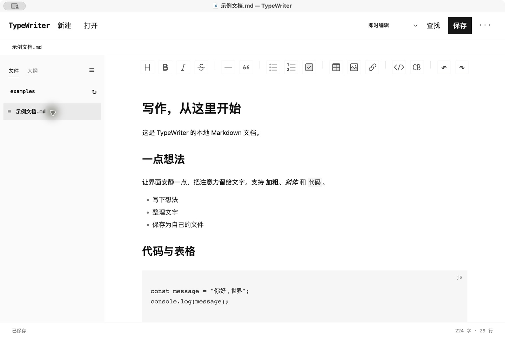

# TypeWriter

一个简洁的本地 Markdown 编辑器。黑白界面，专注写作，文档直接保存到自己的电脑。



- 即时编辑、Markdown 源码、分栏预览与阅读模式
- 文件侧栏、大纲，以及右键新建、重命名和移到废纸篓
- 查找替换、表格、代码块、图片、任务列表
- 专注模式、打字机模式，导出 HTML / PDF
- 未保存提醒、文件冲突检测与草稿恢复

## 运行

需要 Node.js 22.12+。

```sh
npm ci
npm start
```

`npm run package` 打包桌面应用，产物位于 `release/`。目前已在 Apple Silicon Mac 上验证，尚未配置正式签名与公证。

基于 Electron、Toast UI Editor 和 markdown-it。
